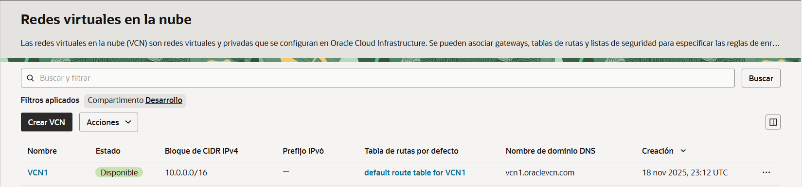
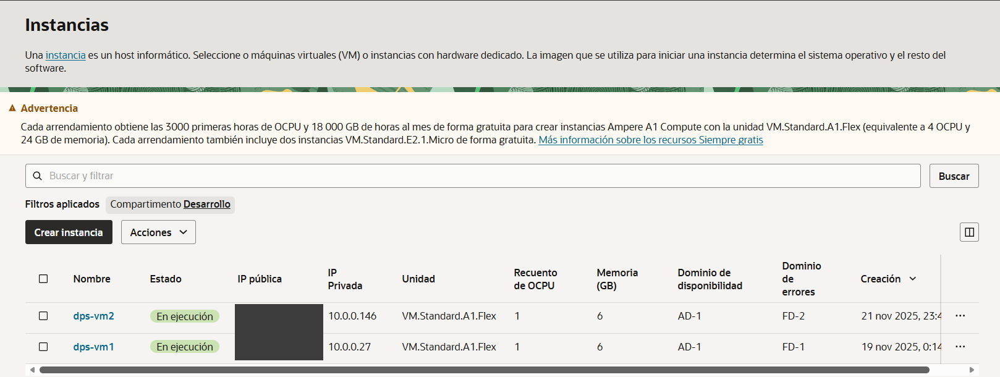
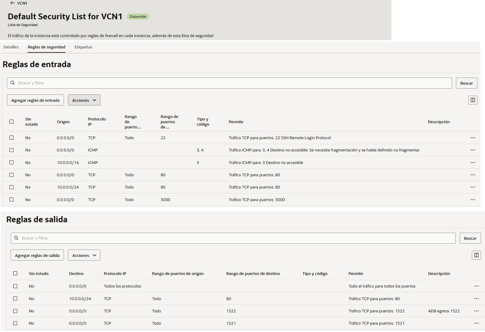

# Bitácora de despliegues en Oracle Cloud (OCI)

Casos reales de deploy y troubleshooting en OCI, en el orden en que los hice. Cada caso sigue el mismo formato: **contexto → arquitectura → problemas (síntoma, diagnóstico, causa, solución) → lecciones**. Incluye un caso que quedó **sin resolver**, documentado tal cual.

| # | Caso | Fecha | Qué agregó | Estado |
|---|---|---|---|---|
| 1 | [Doguito API](#caso-1--doguito-api-primer-deploy) | nov 2025 – ene 2026 | Primer deploy: VM, Autonomous Database con wallet, Load Balancer | Parcial: el endpoint con base de datos termina en `504` |
| 2 | [Sentiment API, 2 VMs](#caso-2--sentiment-api-en-2-vms) | ene 2026 | Arquitectura distribuida: motores de IA en Docker, backend Java, Nginx, red privada | Funcionando durante el hackathon |
| 3 | [Agente RAG autoalojado](#caso-3--agente-rag-autoalojado) | jul – ago 2026 | LLM local (Ollama) en ARM64, Docker Compose de 4 servicios, profiling | Desplegado hasta el 30-ago-2026 |

Todo corrió en instancias **Ampere A1 (`VM.Standard.A1.Flex`, ARM64) con Oracle Linux 9**, dentro de los límites Always Free. Las IP públicas, claves, wallets y URL de PAR se omiten o se reemplazan por marcadores.

> Contexto: estos deploys los hice mientras me formaba en OCI (tengo las certificaciones OCI Foundations y OCI AI Foundations). Para resolver los problemas me apoyé en asistentes de IA; el diagnóstico, las pruebas en la consola y en la terminal y las decisiones fueron míos.

---

## Caso 1 — Doguito API (primer deploy)

**Contexto:** API REST en Node.js de la formación de OCI de Oracle Next Education. Los archivos base y las instrucciones del curso estaban desactualizados frente a las versiones actuales de Oracle Linux y de los paquetes, así que buena parte del trabajo fue adaptarlos.

**Arquitectura:**

```text
Internet ──► Load Balancer (público) ──► dps-vm1: Node.js + PM2 (:3000) ──► Autonomous Database
                                                                              (wallet, driver Thick, :1522)
```

Infraestructura creada en la consola:







### 1.1 Subir el código sin configurar OCI CLI
- **Problema:** mover el `.zip` de la API entre la VM y Object Storage sin instalar ni configurar credenciales de OCI CLI.
- **Solución:** una **Pre-Authenticated Request (PAR)** de escritura sobre el bucket y `curl`:
  ```bash
  curl -X PUT -T doguito-api.zip "https://objectstorage.<region>.oraclecloud.com/p/<TOKEN_PAR>/n/<NAMESPACE>/b/<BUCKET>/o/doguito-api.zip"
  ```
- **Lección:** las PAR sirven para transferencias puntuales sin credenciales en la VM. Las reutilicé en el caso 3.

### 1.2 `NJS-500` / `ECONNRESET` al conectar con la Autonomous Database
- **Síntoma:** la API cortaba la conexión con la base de datos (`NJS-500 … terminated unexpectedly`, `read ECONNRESET`).
- **Diagnóstico (descartar la red primero):**
  ```bash
  sudo dnf install telnet -y
  telnet <host-adb> 1522      # → Connected
  ```
  Con la red y la Security List descartadas (la regla de salida al puerto 1522 estaba creada), el problema tenía que estar en la aplicación.
- **Causa:** el proceso que gestionaba PM2 no recibía `TNS_ADMIN`, así que el driver no encontraba el wallet (`tnsnames.ora` y certificados), y la base cerraba la conexión.
- **Solución:**
  ```bash
  find ~/doguito-api-es -name "tnsnames.ora"   # ubicar el wallet
  export TNS_ADMIN=<ruta-del-wallet>
  npx pm2 restart doguito-api --update-env     # inyectar la variable en el proceso
  npx pm2 describe doguito-api                  # verificar las variables de entorno
  ```

### 1.3 `502` y luego `504` detrás del Load Balancer — **sin resolver**
- **Síntoma inicial:** `502 Bad Gateway` en todas las rutas a través del Load Balancer.
- **Avance:** tras corregir el arranque de la aplicación (driver Thick + wallet), el `502` pasó a `504 Gateway Time-out`, con un patrón claro:
  - `/` a través del Load Balancer → OK (no toca la base de datos);
  - la VM directamente en el puerto 3000 → OK;
  - `/api/clientes` a través del Load Balancer → `504`.
- **Lectura:** la red, la instancia y el Load Balancer funcionaban. El cuello estaba en la consulta a la base de datos, que no respondía antes del timeout del Load Balancer.
- **Hipótesis que quedaron pendientes:**
  1. la primera conexión con el driver Thick y el wallet es lenta o se queda colgada;
  2. el timeout del backend set del Load Balancer es menor que esa primera conexión.
- **Estado:** no lo cerré; pasé a otros proyectos. Lo dejo documentado porque el método (aislar capa por capa) es lo que reutilicé después.

**Lecciones del caso 1:** diagnosticar de afuera hacia adentro; un `502` y un `504` dicen cosas distintas (el backend no responde frente a responde tarde); las variables de entorno de un gestor de procesos no se heredan solas.

---

## Caso 2 — Sentiment API en 2 VMs

**Contexto:** [Hackathon ONE G8](https://github.com/Fernando-Falla/sentiment-analysis-bilstm) (No Country, dic 2025 – ene 2026). Hice el deploy completo en OCI: los dos motores de IA, el backend en Java y el frontend.

**Arquitectura:**

```text
                         ┌──────────────────────── dps-vm1 ────────────────────────┐
Internet ──► :80 Nginx ──┤  /       → frontend estático (/usr/share/nginx/html)    │
                         │  /api/   → proxy_pass → Spring Boot :8000 (systemd, H2) │
                         └───────────────────────────┬─────────────────────────────┘
                                                     │ IP privada (VCN 10.0.0.0/16)
                         ┌──────────────────────── dps-vm2 ────────────────────────┐
                         │  Docker: ml-bi-lstm  :8080 → /predict/v2/sentiment      │
                         │          ml-hibrido  :8081 → /predict/sentiment         │
                         └─────────────────────────────────────────────────────────┘
```

- `ml-bi-lstm`: mi motor (Bi-LSTM con TensorFlow, FastAPI). `ml-hibrido`: el motor del equipo (ML clásico con reglas).
- El backend elige el motor con un parámetro (`?motor=bi-lstm`) y guarda cada análisis en H2.

### 2.1 Dos motores en la misma VM
- **Problema:** las dos imágenes exponen el puerto 8080 dentro del contenedor.
- **Solución:** mapear puertos distintos en el host con Docker Compose (`8080:8080` y `8081:8080`) y probar cada motor por separado con `curl` antes de integrar.

### 2.2 Comunicación entre instancias por la red privada
- **Problema:** el backend en `dps-vm1` debía llamar a los motores en `dps-vm2` sin exponerlos a Internet.
- **Solución:** URLs de los motores con la **IP privada** de `dps-vm2` en `application.properties`, reglas de entrada para 8080 y 8081 desde la subred y `firewalld` en cada VM:
  ```bash
  sudo firewall-cmd --permanent --add-port=8000/tcp
  sudo firewall-cmd --permanent --add-port=80/tcp
  sudo firewall-cmd --reload
  ```
- **Verificación:** `curl` desde `dps-vm1` al motor en `dps-vm2` → `HTTP/1.1 200 OK` (24-ene-2026).

### 2.3 El backend Java no arrancaba como servicio systemd
- **Síntoma:** `sentiment-api.service` terminaba con `status=1/FAILURE` y el log mostraba `Failed to mark memory page as executable`.
- **Diagnóstico:** con `sudo setenforce 0` (SELinux en modo permisivo) el servicio arrancaba. El culpable era **SELinux**, que bloquea la memoria ejecutable que usa el JIT de Java en ARM64, de forma más estricta bajo systemd.
- **Solución:** el arreglo correcto es habilitar solo el permiso que Java necesita (`sudo setsebool -P allow_execmem 1`) y volver a `setenforce 1`, en lugar de dejar SELinux en permisivo. No conservo registro de cuál de las dos configuraciones quedó al final del hackathon.

### 2.4 Nginx como reverse proxy
- **Objetivo:** que el frontend y la API respondan por la IP pública en el puerto 80, sin exponer el 8000.
- **Configuración** (`/etc/nginx/conf.d/sentiment.conf`, resumida):
  ```nginx
  location /api/ { proxy_pass http://localhost:8000; }
  location /     { root /usr/share/nginx/html; }
  ```
  ```bash
  sudo nginx -t && sudo systemctl restart nginx
  ```

### 2.5 La integración funcionaba; la calidad del modelo, no
La prueba de punta a punta (`curl` → Spring Boot → motor Bi-LSTM → H2) respondió bien, pero clasificó como **negativo** un texto claramente positivo. El deploy quedó validado; el modelo, no. La causa probable está en el preprocesamiento: las stopwords de NLTK que se eliminan incluyen negaciones e intensificadores ("no", "muy", "não", "muito"). Se corrige en el reentrenamiento del [repositorio del modelo](https://github.com/Fernando-Falla/sentiment-analysis-bilstm).

**Lecciones del caso 2:** probar cada componente aislado antes de integrar; en Oracle Linux, ante algo que funciona a mano y falla como servicio, sospechar de SELinux y resolverlo con el permiso específico; un deploy correcto no valida un modelo.

---

## Caso 3 — Agente RAG autoalojado

Detalle completo en el repositorio del proyecto: [Agente_IA_wRAG_Challenge](https://github.com/Fernando-Falla/Agente_IA_wRAG_Challenge) (README y `docs/bitacora-tecnica.md`).

- **Infraestructura:** una VM A1.Flex de 2 OCPU / 12 GB con Docker Compose de 4 servicios (Ollama, inicialización de modelos, API FastAPI y UI Streamlit), con `gemma2:2b` y `bge-m3` autoalojados.
- **Red:** timeout desde el navegador con la app sana en `localhost`. Causa: faltaba la regla de entrada en la Security List, una capa independiente de `firewalld`.
- **SELinux:** volúmenes montados con `:z` para que los contenedores puedan leer `data/`.
- **Transferencia de archivos:** PAR de Object Storage + `wget` desde Cloud Shell (lo aprendido en el caso 1).
- **Profiling:** `docker stats` mostró un pico de ~198 % de CPU y ~3,86 GiB de RAM en `ollama`: el CPU limita, no la RAM.
- **Estado:** desplegado de julio al 30 de agosto de 2026; luego se cerró la cuenta de OCI.

---

## Lo que muestra la progresión

1. **Caso 1:** servicios gestionados de OCI (Autonomous Database, Load Balancer, Object Storage) y el primer contacto con la red de la nube.
2. **Caso 2:** una arquitectura distribuida con contenedores, red privada, reverse proxy y endurecimiento del sistema operativo.
3. **Caso 3:** IA generativa autoalojada en ARM64, con decisiones basadas en mediciones de recursos.
